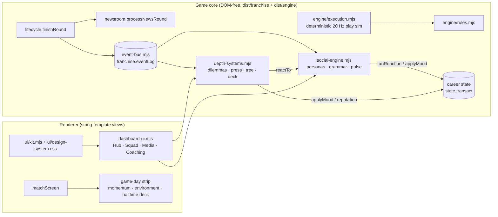

# Overhaul architecture — Hub UI, social engine, depth systems

This phase adds four systems around one new integration spine: a persisted **narrative event log**. Domain code appends events; everything else (social feed, dilemmas, press conferences, cinematics) reads them. The match engine, transaction boundary and save format remain authoritative and unchanged in behaviour.

## System overview

Invariants kept from `AGENTS.md`:

- **Results are never decided by rendering.** The momentum meter and game-day strip only read state. Halftime cards change existing match settings (`personnel`, `shell`, `tempo`) that live and fast paths already share, so no new rule reducer exists.
- **Mutations go through `state.transact`.** Hub actions (`Hub2.dilemma/press/unlock/halftime`) copy, mutate, validate and commit; toasts fire only after commit.
- **Idempotent, additive migration.** `eventLog`, `socialEngine` and `depth` are created lazily with `??=`. Every round-driven write is keyed (`result:<roundKey>`, `social:<year>:<phase>:<week>`, `round:<roundKey>`), so re-settling a round does nothing.
- **Electron sandbox preserved.** The preload uses only `contextBridge`/`ipcRenderer` and exposes the in-game update channels.

## Module map

| Module | Responsibility |
| --- | --- |
| `franchise/event-bus.mjs` | `emitGameEvent` (idempotent by key), `deriveRoundEvents` (result, clutch, blowout, rivalry, streaks, playoff exit, championship, injury spells/returns), `eventsSince` cursor reads |
| `franchise/social-engine.mjs` | 8 archetypes + 6 fan voices, template grammar, anti-repetition memory, per-event casting, sentiment → fan score / drama / chemistry, bounded morale and fan-approval consequences, newsroom transaction bridge, rivalry previews |
| `franchise/depth-systems.mjs` | Locker-room dilemmas, press conferences, coaching tree, momentum, environment, halftime deck |
| `franchise/recruiting-pipeline.mjs` | Draft-prospect pipeline stages, evidence gates, Big Board ranking, positional need, sync with the draft, DraftPick/DraftBust narrative |
| `franchise/dashboard-ui.mjs` | Tabbed Hub view (replaces the Overview; "Classic overview" toggle retained), Matchday game-day strip, `window.Hub2` actions |
| `ui/kit.mjs`, `ui/design-system.css` | Reusable components: `card`, `tabs`, `stat(s)`, `meter`, `momentumBar`, `chip`, `sparkline`, `row`, `post`; tokens, glass surfaces, team-colour theming |
| `desktop/preload.cjs` | Sandboxed IPC surface for in-game updates |

## 1. UI/UX redesign

**Problem → answer.** The Overview was a long single column assembled by stacking regex replacements over earlier templates. The Hub is one view composed from small components on a 12-column bento grid. Four tabs (Hub, Squad, Media & fans, Coaching) replace scrolling. Routes still lead to the existing deep screens.

- **Hub tab (one screen at 1440×900):** matchup hero with team colours, division rank, crowd and narrative chips; Season (2×2 stats); Team pulse (three meters, morale effect, sparkline); Your desk (the active dilemma *or* the pending press question, plus inbox counts); Core players; Leaders; Timeline.
- **Squad tab:** unit segments (Offense / Defense / Special) with position cards, ★ starters, injury and holdout flags. It links to the full depth chart.
- **Media tab:** archetype filters (Insiders / Beat / Hot takes / Fans / Rivals), a 30-post scrollable timeline, and a narrative panel that explains how drama works.
- **Coaching tab:** the skill tree by branch, the decision history and the press record.
- **Theming:** `--team`/`--team-rgb` are set on `<body>` from the career's club, so every accent, hero gradient, chip and meter follows the franchise. Surfaces use translucent fills with `backdrop-filter`. Typography stays with the existing Barlow Condensed display face and DM Sans body face.
- **Responsiveness:** spans collapse at 1280 px to six columns and at 820 px to one column. Reduced-motion users get no meter transitions.

Component contract: each `ui/kit.mjs` function returns HTML and escapes its text arguments. `body`/`html` arguments are trusted markup from other components. New views should compose kit components and avoid extending existing templates with `String.replace`.

## 2. Social media engine

**Grammar.** `{slot}` fills context, `[a|b|c]` picks a seeded variant (choices nest, innermost first), `{?tag:…}` / `{!tag:…}` include text only when the event carries, or lacks, a tag. Tags come from the event: `win`, `loss`, `clutch`, `one-score`, `blowout`, `rivalry`, `playoffs`, `win-streak`, `losing-streak`, `starter`, `season-altering`, `preview`, and so on.

**Casting.** `castFor(event, sentiment)` decides who speaks. The beat writer always posts. The insider joins for big or controversial moments. The hot-take host joins when |sentiment| ≥ 0.4 or for trades, holdouts, busts and pressers. Team, analyst, rival-player and own-player accounts join where they fit, plus one or two fans. Fan replies use six sub-voices (loyalist, doomer, stat nerd, old-timer, meme, cap guy). Each voice has its own bias, and its stance follows what happened: no "best team in football" under a 55–13 loss.

**Determinism and variety.** Each event seeds its own RNG (`eventSeed`), so a save replays identically. A 40-entry `recent` memory rotates templates per archetype and polarity, so the beat writer doesn't repeat itself week to week (covered by a test).

**Sentiment → consequences.** Each post's sentiment is the event's base sentiment × the persona's volatility, plus the persona's bias and seeded noise. Rival players see the inverse. Each round:

- `fanScore += reachWeightedMood × 7`; `fanReaction` moves club fan approval by `round(mood × 3)` (existing ±4 bound).
- `drama = drama × 0.72 + heat`, where heat comes from negative hot takes (9), insider reports (6), fans (2), and trades/holdouts/dilemmas (4).
- `chemistry += win ? 1.5 : −1`, minus `(drama − 60)/8` when drama is high (halved by Culture Builder), plus `mood × 2`.
- `moraleModifier = clamp(round((chemistry − 62)/12 − max(0, drama − 55)/15), −3, 3)` is applied once per round through `applyMood`.
- A hot take that targets a low-leadership player costs that player 2 morale.

**Volume control.** Pre-existing injuries (imported IR, older saves) are baseline. Medical news is capped at the two most significant spells per round. Clutch, blowout and rivalry events ride as tags on `GameResult` rather than separate posts; the standalone events exist for cinematic triggers.

**Coexistence.** `buildSocialFeed` merges engine posts with the existing insider/legends/rumor posts and the comparison polls. The legacy generic fan and player templates now run only before a career's first engine round.

## 3. Depth systems

| System | Trigger | Effects |
| --- | --- | --- |
| Locker-room dilemmas (`DILEMMAS`) | ≤ 1 open; 45 % seeded chance per round; each definition has a `when(state, ctx)` (loss + star, rookie + veteran, drama ≥ 40, 3-win streak) and fires at most once per season | `applyMood` player/team deltas, trust, coach reputation, drama/chemistry, plus a public `LockerRoomDilemma` reaction |
| Press conferences | Latest result / injury / trade / holdout event | Confident / Accountable / Deflect: drama ±, fan score; the quote is posted and reacted to |
| Coaching tree | 1 point per 100 career XP (≈ 4 rounds) | 8 skills in 4 branches, each wired to a real effect (deck size, dilemma morale, chemistry resilience, press drama, confident-answer fan lift, crowd-noise advice) |
| Game-day deck | Halftime, once per game | Context-ranked cards (sacks → Max Protect; trailing → Hurry-Up; …) set `personnel` / `shell` / `tempo` only |
| Momentum and environment | Live match | Decision support only: momentum from the last 10 plays; crowd from home fan score; silent-count and weather advice |

### Recruiting and scouting pipeline

`franchise/recruiting-pipeline.mjs` adds a draft-prospect pipeline (Watchlist → Scouted → Interviewed → Big Board → Drafted), shown as the Hub's **Pipeline** tab. It adds no new economy. Every point-spending or roster action calls the existing `personnel.scout` and `personnel.draftPick`, so costs (Regional 1, Combine / Pro day / Medical 2, Private visit 3), the 30-visit limit, role permissions and roster rules match the classic Scouting and Draft screens.

- **Evidence gates.** *Scouted* requires at least 40 % report confidence. *Interviewed* requires a completed private visit. *Big Board* accepts only scouted prospects. *Drafted* is reached only by an actual selection (`draftDevelopment` record).
- **Sync** (`syncPipeline`) runs after every board action and every settled round. It auto-promotes earned stages (it never demotes, and never pulls a prospect off the Big Board), records targets taken by other clubs, and moves our picks to Drafted.
- **Cards** show the talent range from the report, which narrows as confidence rises, plus positional need against a per-position depth target, the latest scouting note and the recommended next action with its point cost. Big Board cards can be ranked, and show **Draft** while you are on the clock.
- **Roles.** HC/OC/DC careers can build and rank the board, but scouting and pick buttons are hidden behind a "delegated" notice, matching `requireRole(s, "scout")`.
- **Narrative.** Each of our picks emits one `DraftPick` event tagged `first-round`, `on-our-board` or `surprise-pick`, and `scouted` or `unscouted`. Those tags drive dedicated insider, hot-take and team templates and the `LS_DraftNight_Stage` cutscene. A round 1–2 pick whose OVR is below its draft ability + 2 after two full seasons emits one `DraftBust`.

Persisted: `franchise.pipeline = {version, entries{prospectId: {id, stage, added, round?}}, board[ranked ids], lost[≤40], seen[]}`. The Hub remembers the selected position filter for the current session only.

## Presentation layer (in-game 3D, cutscenes, broadcast UI)

The shipped game renders with Three.js r160 inside Electron. `dist/presentation/` upgrades what every player sees, without touching results:

| Module | What it adds |
| --- | --- |
| `stadium-pro.mjs` | Wraps the `Stadium` class through the `window.GridironStadium` hook in `stadium.js`. Adds ACES tone mapping, a shader sky baked into a PMREM environment, and a day → dusk → night progression by quarter. The bowl gains an upper deck, end-zone stands, a roof canopy, jumbotrons and an LED ribbon. A single GPU-animated crowd (about 5,500 instances) uses team colours. Confetti and flashbulbs react to big plays. The **Director** camera (now the default) picks broadcast shots from the play phase (establishing, sideline, SkyCam, ground track, end-zone hero, reverse replay angles). The software renderer path is left untouched. |
| `broadcast-hud.mjs` | TV scorebug (score, possession, period, clock, down & distance, field position), network bug with LIVE/REPLAY, big-play banners driven by the rules engine's result text, replay wipe, and Theater and Fullscreen modes. During a play the bug shows the pre-snap state, and banners wait for the animation to finish, so nothing spoils the result. |
| `cinematics.mjs` | Full-screen cinematics on narrative events: title celebration, draft night, press podium, playoff exit, walk-off win and locker-room confrontation. They are built from `character-stage.createCharacter` with letterbox, title card, skip (Esc/Space/Enter) and an All / Big moments / Off preference. They queue until no play or modal is active. Reduced-motion users get a posed still frame. |
| `theme-motion.mjs` | Adds `body.gd-themed` and a club-derived accent (lightness clamped to 62–72 % so navy clubs stay legible). View-enter transitions and count-up numbers run on view changes. |
| `ui/presentation.css` | Restyles every screen at the shared structural level (sidebar, header, panels, tables, inputs, tabs, dialogs, toasts) by remapping the legacy tokens. Also covers the HUD, cinematics, theater mode and the cinematic title/loading screen. |

`test-presentation.mjs` covers time-of-day selection, Director shot choice and possession mirroring, banner classification, scorebug text, accent contrast and the wiring of the hook, stylesheet and title screen.
## 4. Unreal Engine 5 renderer (removed)

An optional Unreal Engine 5 companion renderer (the `gridiron.ue/1` bridge, the GridironBridge plugin, Pixel Streaming and an in-game download) shipped for Windows during 2026 and was removed in October 2026. Matchday renders on the 2D field by default, with the Three.js stadium one click away; both draw the same deterministic executions.

## Persisted additions

| Path | Shape |
| --- | --- |
| `franchise.eventLog` | `{version, serial, events[≤240], seen[], streak, injured{playerId: "year:week" \| "baseline"}}` |
| `franchise.socialEngine` | `{version, posts[≤160], recent[≤40 template ids], seen[], pulse{fanScore, drama, chemistry}, history[≤40]}` |
| `franchise.depth` | `{version, dilemmas[≤40], pressers[≤40], tree{unlocked[], spent}, halftime[≤40], seen[]}` |

Browser `localStorage` holds only view conveniences: `gridiron-hub-tab`, `gridiron-classic-overview`.

## Verification and limits

- New suites: `test-social-engine.mjs`, `test-depth-systems.mjs` and `test-recruiting-pipeline.mjs` (uses the real `personnel.scout`).
- All suites passed in Chromium through an import-map `node:assert` shim. The full game was exercised in the browser: new career → Hub → quick-sim → Matchday game-day strip → Hub pulse/timeline/press conference → Media and Coaching tabs → reload persistence, with no console errors.
