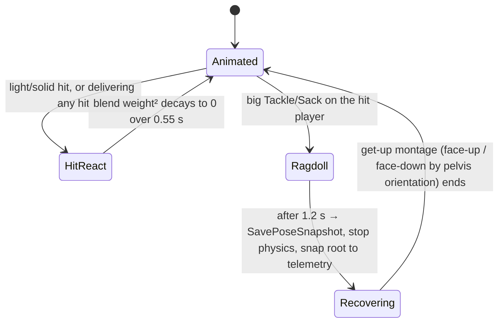
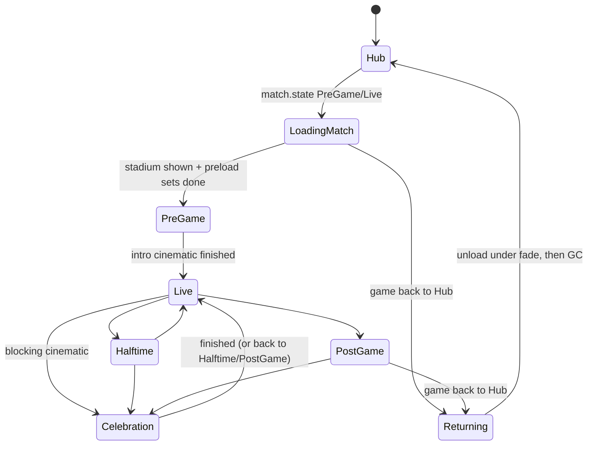

# UE5 match engine: architecture and execution plan

How Gridiron Director drives an Unreal Engine 5 renderer for the 3D match, player models and cinematics, in the data-driven style of modern sports titles. The game stays the single source of truth: it simulates every snap deterministically, then *streams* the result. Unreal interpolates, animates, applies physics reactions, directs cameras and plays cinematics, but never decides an outcome.

Status: the bridge, schemas, renderer hooks and the UE5 C++ plugin source described here are in the repository. The plugin **has not been compiled** (Unreal isn't installed on the machine it was written on), and no art content (skeletal meshes, AnimBPs, Level Sequences, stadium levels) is included. See [Execution plan](#execution-plan).

## 1. System architecture

```mermaid
flowchart LR
  subgraph Game["Gridiron Director (Electron, JS)"]
    SIM[engine/execution.mjs<br/>20 Hz deterministic sim] --> RULES[rules.mjs applies result]
    SIM -->|execution: actors, frames, events| TEL[bridge/ue-telemetry.mjs]
    BUS[(event log)] -->|narrative events| TEL
    LIVE[state.live] -->|flow| TEL
    TEL --> HOOKS[bridge/ue-hooks.mjs]
  end
  HOOKS -->|IPC via sandboxed preload| RELAY[desktop/ue-bridge.cjs<br/>ws://127.0.0.1:47800<br/>validates + size-limits]
  RELAY <-->|WebSocket, JSON| SUB
  subgraph UE["Unreal Engine 5 — GridironBridge plugin"]
    SUB[UGridironBridgeSubsystem<br/>parse, strip nulls, typed delegates]
    SUB -->|OnPlayCall / OnFrames / OnCollision| MD[AGridironMatchDirector<br/>telemetry buffer + playback clock]
    MD -->|ApplySample| ATH[22 × AGridironAthlete<br/>AnimBP locomotion]
    MD -->|ReceiveCollision| ATH
    ATH -->|PhysicalAnimation / ragdoll| PHYS[Chaos physics]
    MD -->|UpdateFrame / NotifyCollision| CAM[AGridironBroadcastDirector<br/>CineCamera rigs + DOF]
    SUB -->|OnCinematic| SEQ[UGridironSequenceManager<br/>template Level Sequences]
    SUB -->|OnMatchState| FLOW[UGridironFlowSubsystem<br/>state machine + async loading]
    FLOW --> SEQ
    SEQ -->|NotifyCinematicFinished| FLOW
    FLOW -->|SetHeld false| MD
    FLOW -->|ue.flow.state| SUB
    SEQ -->|ue.cutscene.finished| SUB
  end
```



**Per-snap timeline.** The rules engine resolves the play first; telemetry follows within the same frame:

```
game:   resolveSnap ─► play.call ─► player.frames #0 … #n (12 frames each) ─► physics.collision × k
UE:     PlayCall → configure 22 athletes, cameras on their marks
        frames → buffer; playback clock starts at −SnapLeadIn (0.4 s)
        tick → T = playback − RenderDelay (0.12 s) → Hermite sample → athletes, ball, cameras
        collision.t ≤ T → hit react / ragdoll on target + instigator, camera impact punch-in
        T > duration + 0.5 → OnPlayFinished
```

Unreal never waits on the game mid-play: the whole play arrives in well under a frame over loopback, so the render delay only absorbs scheduling jitter.

**Invariants carried over from `AGENTS.md`:** results come only from the game's execution and rules reducers; the relay binds to loopback, validates every message, enforces direction (game types out, `ue.*` types in) and caps messages at 4 MB; the Electron renderer keeps its sandbox, and the preload exposes only the bridge channel.

## 2. Data schemas

All messages share the `gridiron.ue/1` envelope `{protocol, type, seq, sentAt, payload}`. The authoritative JSON Schema (draft 2020-12) is [`dist/bridge/ue-schema.json`](../dist/bridge/ue-schema.json). Builders live in [`dist/bridge/ue-telemetry.mjs`](../dist/bridge/ue-telemetry.mjs).

**Units and space.** Centimetres from midfield; +X toward the end zone the offense attacks (the `direction` field mirrors for away possessions so both teams play the right way); +Y to the home sideline; +Z up; yaw in degrees about +Z; velocities in cm/s. Missing indices are `-1`, not `null`.

| Type | Direction | Payload | When |
| --- | --- | --- | --- |
| `play.call` | → UE | **PlayCallData** | Once per snap, before frames |
| `player.frames` | → UE | Chunk of **PlayerCoordinateFrame** (`playId`, `chunk`, `final`, `frames[]`) | 10 Hz samples, 12 per message |
| `physics.collision` | → UE | **PhysicsCollisionEvent** | One per tackle, sack, broken tackle and first line engagement |
| `cinematic.trigger` | → UE | **CinematicTrigger** | Narrative events (title, draft pick, presser, walk-off…) |
| `match.state` | → UE | **MatchState** | When the game's flow state or match changes |
| `ue.flow.state` | ← UE | `{state}` incl. Unreal-only `Celebration`/`Returning` | On every Unreal flow transition |
| `ue.cutscene.finished` | ← UE | `{eventId, skipped}` | When a cinematic ends |

Example **PlayCallData** (roster trimmed to 2 of 22):

```json
{ "playId": "2026-3-41", "seed": 3112709, "offenseTeam": 16, "defenseTeam": 13, "direction": 1,
  "offense": { "call": "Deep pass", "formation": "Shotgun spread", "personnel": "11", "tempo": "Normal" },
  "defense": { "front": "Nickel", "coverage": "Cover 3", "shell": "2-High" },
  "situation": { "down": 3, "toGo": 7, "spot": 42, "quarter": 2, "clock": 431, "score": [10, 7] },
  "weather": "Clear", "duration": 5.9, "tickRate": 20,
  "roster": [
    { "index": 0, "id": "p-qb-04", "name": "Starting QB", "role": "QB", "jersey": 4, "side": "offense", "team": 16, "heightCm": 191, "massKg": 102 },
    { "index": 18, "id": "p-cb-22", "name": "Nickel CB", "role": "CB", "jersey": 22, "side": "defense", "team": 13, "heightCm": 180, "massKg": 87 } ] }
```

Example **PlayerCoordinateFrame** (players trimmed):

```json
{ "t": 2.4,
  "players": [ { "index": 0, "x": -1189, "y": 41, "z": 0, "yaw": 3, "vx": 52, "vy": -10, "speed": 54 },
               { "index": 2, "x": 1463, "y": -1726, "z": 0, "yaw": -12, "vx": 702, "vy": -141, "speed": 716 } ],
  "ball": { "x": 210, "y": -840, "z": 610, "vx": 1905, "vy": -1040, "vz": 128, "carrier": 0 } }
```

Velocities are central differences of the authoritative positions, so Unreal's Hermite interpolation and short dead-reckoning never invent motion the engine didn't produce.

Example **PhysicsCollisionEvent**:

```json
{ "playId": "2026-3-41", "t": 4.8, "kind": "Tackle", "instigator": 20, "target": 2,
  "location": { "X": 2286, "Y": -1951, "Z": 91 }, "normal": { "x": 0.83, "y": -0.56, "z": 0 },
  "closingSpeed": 1180, "impulse": 541, "severity": "solid", "bodyRegion": "upper" }
```

`impulse` (N·s) = reduced mass of the two players (role masses in `ROLE_MASS`) × closing speed. Severity bands: `light` < 420 ≤ `solid` < 780 ≤ `big`. Blocks are detected as the first time each offensive lineman closes within 1.1 yd of a defensive lineman in the first 2.5 s.

Example **CinematicTrigger** (cast trimmed):

```json
{ "eventId": "evt-212", "kind": "Championship", "template": "LS_Championship_Celebration",
  "priority": 100, "skippable": false, "blocking": true,
  "teams": { "home": { "id": 16, "abbr": "DAL", "name": "Cowboys", "city": "Dallas",
                       "colors": { "primary": "#29588a", "secondary": "#f0f2ee" },
                       "uniform": { "jersey": "#29588a", "pants": "#c9ced3", "helmet": "#29588a", "set": "Home" } },
             "away": { "id": 13, "abbr": "KC", "name": "Chiefs", "…": "…" } },
  "cast": [ { "slot": "HeadCoach", "playerId": "coach", "name": "Alex Morgan", "number": -1, "pos": "HC", "team": 16,
              "appearance": { "skin": "#b77b51", "hair": "#25211c", "build": "Athletic", "heightCm": 183 } },
            { "slot": "Star", "playerId": "p-wr-88", "name": "Star WR", "number": 88, "pos": "WR", "team": 16, "appearance": { "heightCm": 185 } } ],
  "environment": { "timeOfDay": "Night", "weather": "Clear", "crowd": 85, "stadium": "DAL" },
  "text": { "score": [31, 24], "year": 2026, "week": 21 } }
```

`blocking: true` (priority ≥ 80: title, draft night) freezes live telemetry playback until the sequence finishes.

## 3. UE5 implementation

Plugin: [`unreal/GridironBridge`](../unreal/GridironBridge). Modules: Core, CoreUObject, Engine, WebSockets, Json, JsonUtilities, LevelSequence, MovieScene, CinematicCamera. Targets UE 5.3+.

| Class | Responsibility |
| --- | --- |
| `UGridironBridgeSubsystem` (GameInstance) | WebSocket client with auto-reconnect; strips JSON nulls (the struct converter stops at the first value it can't convert); typed delegates `OnPlayCall`, `OnFrames`, `OnCollision`, `OnCinematic`, `OnMatchState`; `ReportFlowState`, `ReportCutsceneFinished` |
| `FGridironTelemetryBuffer` | Ordered, de-duplicated frames per play; cubic Hermite position interpolation using sample velocities; shortest-arc yaw; up to 150 ms dead-reckoning if the stream stalls, then hold |
| `AGridironMatchDirector` | Pools 22 athletes at BeginPlay (no spawning mid-play); playback clock `T = elapsed − RenderDelay`; applies samples via the field-origin transform; fires collisions at their timestamp on both participants; feeds the camera director; `SetHeld` for blocking cinematics |
| `AGridironAthlete` (Pawn) | Root follows telemetry; exposes `Speed`, `Direction`, `LeanAngle`, `bHasBall` to the AnimBP; `EGridironBodyState` machine for animation ↔ physics blending (below) |
| `AGridironBroadcastDirector` | One `ACineCameraActor` per rig; locked modes or Director cutting; per-shot lens (focal length, aperture); manual focus distance tracks the subject every frame; impact camera shake |
| `UGridironSequenceManager` (World) | Async-loads template sequences, performers and weather; personalises performers via `IGridironPerformerInterface::ApplyPerformer`; binds them by tag; sets lighting, weather and team-colour material parameters; priority interrupt and queue |
| `UGridironFlowSubsystem` (GameInstance) | Flow state machine, async stadium level-instance streaming, preload sets, camera fades, intro cinematic, hold release, GC only in the hub |

### Locomotion and interpolation

22 skeletal meshes is a light load for UE5 if each one is cheap: use one shared AnimBP with a 2D blend space (Speed × Direction) plus lean, **Animation Budget Allocator** to throttle distant players' anim updates, update-rate optimisation (URO) on the meshes, and LOD'd skeletons. Telemetry arrives at 10 Hz. The buffer samples at display rate 120 ms behind the newest frame and Hermite-interpolates with the transmitted velocities, so motion stays C1-continuous (no velocity pops at sample boundaries). For more fidelity, add **Motion Matching** (UE 5.4+ Pose Search) with telemetry trajectories as the query, which removes foot sliding on cuts.

### Animation ↔ physics blending



- **HitReact:** `ApplyPhysicalAnimationProfileBelow(spine_01 | pelvis, "HitReact")` → `SetAllBodiesBelowSimulatePhysics` → blend weight 0.4 (light / instigator) or 0.75 (solid) → `AddImpulseAtLocation` along the collision normal. Physical-animation motors keep simulated bones chasing the animated pose, so it reads as a stagger, not a collapse.
- **Ragdoll:** full simulation and impulse at the pelvis. Telemetry keeps updating a *pending* root transform without moving the actor (moving it would drag simulated bones); the root snaps there when the get-up starts.
- **Get-up:** the AnimBP's Pose Snapshot node blends from the frozen physics pose into the montage.
- Author a `HitReact` profile in the Physics Asset (strong orientation, moderate position strength).

### Broadcast camera system

| Shot | Rig placement (field-local) | Lens |
| --- | --- | --- |
| All-22 | 26 m behind the line of scrimmage, 28 m high, looking 9 m downfield | 24 mm, f/11 |
| Offense focus | 9.5 m behind the QB, 3.3 m high | 28 mm, f/5.6 |
| Defense focus | 23 m past the line, 6.5 m high, facing the offense | 35 mm, f/5.6 |
| Sideline wide | 50-yard press box (−43 m Y, 15 m high), tracking the subject | 35 mm, f/8 |
| Sideline tight | −36 m Y, 7 m high, on the carrier | 85 mm, f/2.8 |
| Cable cam | 13 m behind and 9.5 m above the ball, looking 0.35 s ahead | 30 mm, f/4 |
| Impact | Sideline tight punch-in for 0.8 s on big hits, with shake | 135 mm, f/2 |

Director rules: wide before the snap → offense focus for 0.6 s → cable cam while the ball is in the air → sideline tight on the ball carrier → impact punch-in on big hits → wide when the play ends. Every shot holds at least 1 s (impacts exempt). Incoming rigs are placed on their mark *before* the cut. Depth of field is procedural: manual focus distance equals the camera-to-subject distance each frame, with smoothing.

### Dynamic cinematics

Author each template Level Sequence once, with possessable tracks tagged by cast slot (`HeadCoach`, `Star`, `Prospect`, `Captain`, `Subject`). At runtime `UGridironSequenceManager`:

1. Async-loads the sequence, performer classes, weather actor and team material parameter collection (`StreamableManager`).
2. Applies the environment: `GridironSun` directional light and `GridironSky` sky light from the lighting preset for `timeOfDay`, a weather actor, and `HomePrimary/AwayPrimary/CrowdDensity` on the parameter collection (stadium dressing reads these).
3. Spawns a performer per slot, calls `ApplyPerformer(performer, teamLook)` (jersey colours, number and name decals, MetaHuman skin/hair/build, height scale), and calls `SetBindingByTag(slot, {actor})`.
4. Plays, then cleans up, reports `ue.cutscene.finished`, notifies the flow subsystem and starts the next queued cinematic. A higher-priority trigger interrupts; missing templates finish immediately as skipped so the game never stalls.

### Game flow state machine



Hitch-avoidance checklist:
- Stadium as `ULevelStreamingDynamic::LoadLevelInstanceBySoftObjectPtr`; wait for `OnLevelShown`.
- Uniform and performer sets via `RequestAsyncLoad`, keyed by the `match.state.preload` hints; handles held for the match and released on return.
- Camera fade covers every content swap; athletes are pooled; no `LoadObject`/`SpawnActor` of new classes during live play.
- Shader hitching: enable PSO precaching (`r.PSOPrecaching=1`) and ship a bundled PSO cache recorded from a playthrough.
- Garbage collection only in `Hub` (forced once after unload); never mid-match.
- The intro and celebrations are blocking, so the match director holds telemetry while they play; non-blocking cinematics play over the live view.

## Execution plan

Effort assumes one developer part-time, with Claude writing code and editor scripts and the developer operating the Unreal editor.

| Phase | Deliverable | Acceptance check | Effort |
| --- | --- | --- | --- |
| 0. Toolchain | UE 5.4+, Visual Studio 2022 (C++ game workload), plugin compiles, game connects with `GRIDIRON_UE=1` | `ue.ready` received; `match.state` arrives on entering Matchday | 1–3 days |
| 1. Greybox replay | Placeholder field, 22 mannequins, `AGridironMatchDirector` + buffer, Director camera | A full play replays in sync with the game's 3D view; no visible pops at chunk boundaries | 1–2 weeks |
| 2. Locomotion | Football skeleton/mesh (Fab/MetaHuman body), shared AnimBP blend space, budget allocator | 60 fps at 1440p with 22 players; no foot sliding at walk/jog/sprint | 2–4 weeks |
| 3. Contact | Physics Asset `HitReact` profile, ragdoll tuning, get-up montages | Light/solid hits stagger; big tackles ragdoll and recover within 2.5 s; nobody leaves the telemetry path | 2–4 weeks |
| 4. Broadcast | Rig tuning, DOF, impact shake, All-22 and focus modes, replay angles | Shots never cut more than once per second; subject always in focus | 1–2 weeks |
| 5. Stadium | Stadium level instance, team-colour material parameter collection, lighting presets, weather actors | Team colours and time of day correct for any matchup | 2–4 weeks |
| 6. Cinematics | Six templates (walkout, title, draft, presser, playoff exit, walk-off) with tagged slots and MetaHuman performers | Any team and player renders correctly; skip works; queue and priority behave | 3–6 weeks |
| 7. Flow and packaging | Flow subsystem wired to content, PSO cache, Windows packaging beside the Electron app | Hub → match → celebration → hub with no hitch over 33 ms in Unreal Insights | 1–2 weeks |

**Total:** about 3–6 months part-time. Content (animation quality in phases 2–3 and 6) dominates the schedule and any spend: marketplace football animation packs, or motion capture for realism.

**Risks.** Motion-matching data for football-specific moves is scarce (budget for mocap or a contractor). UE Mac builds require a Mac, so ship Windows first. A UE build adds roughly 2–10 GB to the download. MetaHuman licensing allows use in Unreal-rendered products; check the terms for any likeness of real players.

## Verification

- `test-ue-telemetry.mjs` builds every payload from real `simulateExecution` output and checks schema-required fields, chunk coverage, velocity consistency, coordinate mirroring, collision physics and flow-state derivation. The relay allow-list test covers the new types.
- Not verified: compiling or running the UE5 plugin, the Physics Asset tuning and any art content. Expect small API adjustments per engine version.
